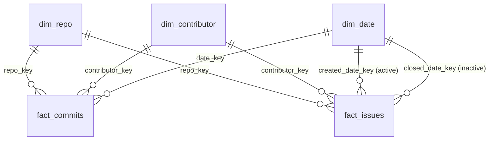

# Data Engineering Semester Project
## Open-Source Repository Analytics Pipeline

**Team Members:**
- Abdullah Zahid — 24L-2597
- Haseeb Nadeem — 23L-2646

**Repository:** https://github.com/abdullah123-droid/DataEngineering

---

## Project Overview

This project analyzes open-source software repository activity — commit frequency,
issue lifecycle, and contributor engagement — across 18 popular, actively maintained
GitHub repositories (e.g. facebook/react, apache/spark, kubernetes/kubernetes,
pandas-dev/pandas). Data is ingested via the GitHub REST API and processed through
a Medallion (Bronze/Silver/Gold) architecture using Apache Spark on Databricks.

## Data Source

GitHub REST API (`https://api.github.com`):
- `GET /repos/{owner}/{repo}/commits`
- `GET /repos/{owner}/{repo}/issues`

**Full Load:** Historical pull bounded by an 18-month lookback window per repository
(to keep large, high-velocity repos like kubernetes/kubernetes and tensorflow/tensorflow
from disproportionately inflating data volume).

**Incremental Load:** Pulled via the `since` parameter, capturing new and updated
records after a given watermark timestamp.

## Repository Structure

```
DataEngineeringProject/
├── data/samples/              # Phase 1 sample files (full + incremental load, PII-hashed)
├── ingestion/                 # Phase 1: GitHub API ingestion scripts
│   ├── fetch_github_data.py
│   ├── anonymize_samples.py
│   └── trim_samples.py
└── pipeline/                  # Phase 2: Bronze/Silver Spark pipeline (Databricks)
    ├── Bronze/bronze_ingest.py
    ├── Silver/silver_transform.py
    └── Utils/
        ├── schemas.py
        └── audit_logger.py
```

## Security & Compliance

All personal data (author/committer emails, names, GitHub usernames) is SHA-256
hashed with a project-specific salt before being committed to this repository.
No raw emails, usernames, or profile URLs are present in any sample file or
pipeline table. See `data/samples/` for the hashed sample files.

---

# Phase 2: Engineering Pipeline

## Bronze Layer Data Model

### bronze_commits
| Column | Type | Notes |
|---|---|---|
| sha | STRING | **Primary key** |
| commit | STRUCT<author, committer, message> | Nested, as received from source |
| html_url | STRING | |
| author | STRUCT<login, type, site_admin> | GitHub account object (hashed login) |
| committer | STRUCT<login, type, site_admin> | GitHub account object (hashed login) |
| _repo | STRING | Repository identifier |
| load_timestamp | TIMESTAMP | When this record was ingested into Bronze |
| load_type | STRING | "full" or "incremental" |

### bronze_issues
| Column | Type | Notes |
|---|---|---|
| id | LONG | GitHub issue ID |
| number | LONG | Part of composite key with _repo |
| title | STRING | |
| user | STRUCT<login, type, site_admin> | Hashed reporter identity |
| state | STRING | open / closed |
| created_at, updated_at, closed_at | STRING | Raw ISO8601 strings (cast happens in Silver) |
| comments | LONG | |
| labels | ARRAY<STRUCT<id, name, color>> | |
| _repo | STRING | |
| load_timestamp | TIMESTAMP | When this record was ingested into Bronze |

## Silver Layer Data Model

### silver_commits
| Column | Type | Notes |
|---|---|---|
| commit_sha | STRING | **Primary key** (merge key) |
| repo_name | STRING | |
| author_name_hash | STRING | |
| author_email_hash | STRING | |
| authored_at | TIMESTAMP | Cast from string |
| committer_name_hash | STRING | |
| committed_at | TIMESTAMP | Cast from string |
| message | STRING | |
| author_login_hash | STRING | |
| load_type | STRING | |
| load_timestamp | TIMESTAMP | When this record was processed into Silver |

### silver_issues
| Column | Type | Notes |
|---|---|---|
| repo_name | STRING | **Primary key (composite with issue_number)** |
| issue_number | INT | **Primary key (composite with repo_name)** |
| title | STRING | |
| reporter_login_hash | STRING | |
| state | STRING | |
| created_at, updated_at, closed_at | TIMESTAMP | Cast from string |
| comment_count | INT | |
| load_type | STRING | |
| load_timestamp | TIMESTAMP | |

## pipeline_execution_logs (audit table)
| Column | Type |
|---|---|
| run_id | STRING |
| layer | STRING |
| parameter | STRING |
| start_time | TIMESTAMP |
| end_time | TIMESTAMP |
| status | STRING |
| rows_affected | LONG |
| error_message | STRING |

## Execution Guide

### Standard incremental load
Set widgets in `bronze_ingest`:
- `input_path` → path to the new incremental JSON file
- `load_type` → `"incremental"`

Run the notebook, then run `silver_transform` to merge the new data in.

### Backfill (any historical file)
Set `input_path` to any older/historical file's path instead of the current one —
nothing is hardcoded to "today." Bronze is append-only, so re-running is safe.
Silver uses MERGE INTO, so re-running it is always idempotent — verified by zero
duplicate `commit_sha` / `(repo_name, issue_number)` pairs after multiple runs on
the same data.

## Team Contributions (Phase 2)
| Component | Owner |
|---|---|
| Databricks environment setup, Bronze ingestion (`bronze_ingest.py`), schema definitions (`schemas.py`) | Abdullah Zahid (24L-2597) |
| Silver transformation (`silver_transform.py`), MERGE INTO / idempotency logic, audit logging (`audit_logger.py`), README data dictionary | Haseeb Nadeem (23L-2646) |


---

# Phase 3: Gold Layer, Orchestration and Dashboard

## Gold Layer Data Model (star schema)



### fact_commits (grain: one row per commit)
| Column | Type | Notes |
|---|---|---|
| commit_sha | STRING | **Primary key** (MERGE key) |
| repo_key | BIGINT | FK to dim_repo.repo_key |
| contributor_key | STRING | FK to dim_contributor.contributor_key ('unknown' if null) |
| date_key | INT | FK to dim_date.date_key (yyyyMMdd of authored_at) |
| authored_at | TIMESTAMP | |
| hour_of_day | INT | Derived from authored_at |
| message_length | INT | Derived: length of commit message |
| load_timestamp | TIMESTAMP | When the row was written to Gold |

### fact_issues (grain: one row per issue)
| Column | Type | Notes |
|---|---|---|
| repo_key | BIGINT | **Primary key (composite with issue_number)**, FK to dim_repo |
| issue_number | INT | **Primary key (composite with repo_key)** |
| contributor_key | STRING | FK to dim_contributor (reporter) |
| created_date_key | INT | FK to dim_date.date_key (active relationship) |
| closed_date_key | INT | FK to dim_date.date_key (inactive relationship; null while open) |
| state | STRING | open / closed |
| comment_count | INT | |
| days_to_close | INT | Derived: datediff(closed_at, created_at); null while open |
| is_closed | BOOLEAN | Derived: state = 'closed' |
| load_timestamp | TIMESTAMP | |

### dim_repo
| Column | Type | Notes |
|---|---|---|
| repo_key | BIGINT | **Primary key**, xxhash64(repo_name) |
| repo_name | STRING | e.g. facebook/react |
| repo_owner | STRING | |
| repo_short_name | STRING | |
| load_timestamp | TIMESTAMP | |

### dim_contributor
| Column | Type | Notes |
|---|---|---|
| contributor_key | STRING | **Primary key**, hashed login (no raw identity) |
| first_seen_at | TIMESTAMP | Earliest commit or issue by this contributor |
| load_timestamp | TIMESTAMP | |

### dim_date
| Column | Type | Notes |
|---|---|---|
| date_key | INT | **Primary key**, yyyyMMdd |
| full_date | DATE | |
| year, month, day, week_of_year | INT | |
| month_name, day_name | STRING | |
| is_weekend | BOOLEAN | |
| load_timestamp | TIMESTAMP | |

### Read optimisation
Liquid Clustering plus `OPTIMIZE` on the two fact tables:
- `fact_commits` clustered by `(repo_key, date_key)`
- `fact_issues` clustered by `(repo_key, created_date_key)`

At the current sample size each table is a single file, so no speed-up is measurable yet; the clustering is a design choice for larger volumes.

## Audit coverage
`pipeline_execution_logs` also records one row per Gold table (`Silver-to-Gold-dim_repo`, `-dim_contributor`, `-dim_date`, `-fact_commits`, `-fact_issues`), including `rows_affected` and start and end time.

## Running the whole pipeline (Bronze, Silver, Gold)

Open `Orchestration/run_pipeline` in Databricks and set the widgets:

| Widget | Standard incremental load | Backfill |
|---|---|---|
| `input_path` | `/Volumes/workspace/default/raw_files/incremental_load_sample.json` | path of any older file |
| `load_type` | `incremental` | `full` or `incremental` |
| `batch_param` | e.g. `incremental_run` | e.g. `backfill_<date>` |

Run the notebook. It calls `bronze_ingest`, then `silver_transform`, then `gold_transform` in sequence and stops if any step fails.

Check the result:
```sql
SELECT layer, parameter, status, rows_affected, start_time, end_time
FROM pipeline_execution_logs ORDER BY start_time DESC;
```

## Idempotency check for Gold
Run `gold_transform` twice and compare counts: `fact_commits` 1,538, `fact_issues` 1,873, `dim_repo` 18 both times.

## Dashboard
`dashboard/GitHub_Analytics_Dashboard.pbix`
- Page 1, Repository analytics: commits over time by repository, average days to close, total commits and issues, contributor concentration, repository slicer.
- Page 2, Pipeline monitoring: run history, rows processed by layer, average duration by layer, success versus failure, and an error log filtered to failed runs.

## Final report
`docs/Final_Architecture_FinOps_Report.pdf` contains the architecture diagram, decision log, Spark DAG analysis and FinOps evaluation.

## Team contributions (Phase 3)
| Component | Owner |
|---|---|
| Gold transformations, orchestration notebook, Power BI model and dashboard | Abdullah Zahid (24L-2597) |
| Gold data dictionary, decision log | Haseeb Nadeem (23L-2646) |

